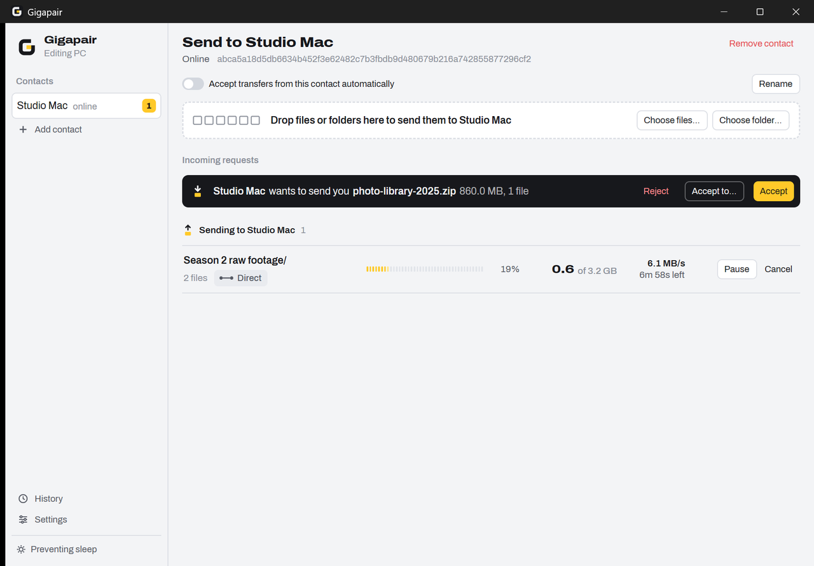

<p align="center">
  <picture>
    <source media="(prefers-color-scheme: dark)" srcset="docs/images/logo-dark.svg">
    
  </picture>
</p>

<p align="center"><b>Move huge files between the devices you trust. Pair once, send anytime.</b></p>

Gigapair is a desktop app and CLI for sending very large files (tens to hundreds of GB, any type) directly between two computers: peer-to-peer, end-to-end encrypted, verified and resumable. No cloud storage, no size limits, no new code for every transfer.

<p align="center">
  <picture>
    <source media="(prefers-color-scheme: dark)" srcset="docs/images/window-dark.png">
    
  </picture>
</p>

*Originally built to send talk recordings between the organizers of [builderia.lat](https://builderia.lat).*

> **Status:** beta. Windows, macOS and Linux builds are on the [releases page](https://github.com/dopazo/gigapair/releases); the first real-network acceptance tests are still in progress.

## Why Gigapair

- **Survives interruptions.** If the network drops, the app closes or a computer reboots, the transfer resumes where it stopped. Blocks already verified are never sent again.
- **Every byte checked.** Each 4 MiB block is verified with BLAKE3 as it arrives, and a file only gets its final name once its root hash matches.
- **No double disk space.** Data is written next to its destination and renamed into place: a 200 GB file needs 200 GB free, not 400 GB.
- **Doesn't stall when a computer sleeps.** Gigapair keeps the system awake only while a transfer runs.
- **Contacts, not codes.** Pair two devices once with a code or QR and a 4-word check, then drop files onto the contact. A headless server can receive on its own with auto-accept.
- **Works behind NAT and CGNAT.** Direct connection with hole punching, and an encrypted relay as a fallback. Every transfer shows whether it is **direct** or **via relay**, and which relay.

## Privacy

No telemetry, and no network traffic except to your contact and, when needed, a relay (plus GitHub's list of releases, only when you click **Check for updates**). A relay only forwards end-to-end encrypted data; it can see both IP addresses and how much is sent. You can run your own relay or allow **direct connections only**. Details in [How it works](docs/how-it-works.md#privacy-and-relays).

## Install

Download from the [releases page](https://github.com/dopazo/gigapair/releases). Every package contains the desktop app (`gigapair-app`), the CLI (`gigapair`, alias `gpair`) and the background service (`gigapaird`).

| Platform | How |
| --- | --- |
| Windows 10/11 | `gigapair-x86_64-pc-windows-msvc.msi`: adds **Gigapair** to the Start menu, the CLI to the `PATH`, and a firewall exception for the service |
| macOS 11+ (Apple silicon and Intel) | `gigapair-aarch64-apple-darwin.dmg` (Apple silicon) or `gigapair-x86_64-apple-darwin.dmg` (Intel): open it and drag **Gigapair** to Applications. The first launch needs one confirmation (see below). The CLI is inside the app; the shell installer below also works |
| Linux (x86_64, glibc 2.35+) | Debian, Ubuntu and derivatives: `gigapair-x86_64-unknown-linux-gnu.deb`, with `sudo apt install ./gigapair-x86_64-unknown-linux-gnu.deb`. Fedora 36 or newer: the `.rpm`, with `sudo dnf install ./gigapair-x86_64-unknown-linux-gnu.rpm`. Both add Gigapair to the application menu and install for all users; remove it with `sudo apt remove gigapair` (or `dnf remove`), which also deletes each user's login entry for the service but keeps contacts and received files. Any other distribution (including openSUSE, whose package names differ, and RHEL 9, Rocky and AlmaLinux 9, whose glibc is too old): the shell installer below, then run `gigapair-app` |

Or install from a terminal, which also suits servers:

```sh
# macOS and Linux
curl --proto '=https' --tlsv1.2 -LsSf https://github.com/dopazo/gigapair/releases/download/v0.1.0-beta.4/gigapair-installer.sh | sh

# Windows (PowerShell): downloads the MSI and installs it with a progress bar
$msi = "$env:TEMP\gigapair.msi"; $log = "$env:TEMP\gigapair-install.log"
iwr https://github.com/dopazo/gigapair/releases/download/v0.1.0-beta.4/gigapair-x86_64-pc-windows-msvc.msi -OutFile $msi
$p = Start-Process msiexec -ArgumentList "/i `"$msi`" /passive /norestart /l*v `"$log`"" -Verb RunAs -Wait -PassThru; if ($p.ExitCode -in 0, 3010) { 'Gigapair installed.' } else { "Install failed (msiexec exit code $($p.ExitCode)). Log: $log" }
```

On Windows, press Enter if the last line is still waiting after you paste. So far there are only pre-releases, which GitHub never marks as *latest*: replace the version with the newest one on the releases page. Unattended installs (scripts, servers, AI agents), installing without administrator rights and setting up a server that receives on its own are in [docs/usage.md](docs/usage.md#from-a-terminal).

The binaries are not code-signed yet. On Windows, SmartScreen asks once: **More info → Run anyway**. On macOS the first launch is blocked: open **Gigapair** once, then go to **System Settings → Privacy & Security**, scroll down to the message about Gigapair and click **Open Anyway** (or run `xattr -dr com.apple.quarantine /Applications/Gigapair.app`). macOS asks only once. Every release ships SHA-256 checksums and [build attestations](https://docs.github.com/en/actions/security-for-github-actions/using-artifact-attestations) (`gh attestation verify <file> --repo dopazo/gigapair`).

## Use

**Desktop app**

1. **Pair:** click **Add contact** and send the code (or the QR) to the other person by any channel; they paste it under **Add contact**. Check that both screens show the same four words.
2. **Send:** drop files or folders onto the contact.
3. **Receive:** accept the request, or turn on **Accept transfers from this contact automatically**.

Closing the window keeps Gigapair in the tray, and transfers keep going in the background service.

**CLI**

The CLI does everything the app does, so a machine that only receives (a home server, a NAS, a render node) needs no desktop at all: pair it once, turn on auto-accept, and it takes files on its own. It also suits scripts and AI agents that move files for you: commands can run without prompts (`pair --yes`, `send --no-wait`), contacts and transfers accept short names, and `status` and `history` report what happened.

```sh
gigapair pair                         # show a pairing code (and a QR)
gigapair pair <code>                  # add a contact from the other device's code
gigapair send <contact> <paths...>    # send files or folders
gigapair status --watch               # progress, speed, direct or relay
```

All commands, headless servers, settings, where data is stored and logs: [docs/usage.md](docs/usage.md).

### Use Gigapair from AI agents

The [Gigapair skill](skills/gigapair/SKILL.md) teaches an agent how to install Gigapair, send and receive files with the CLI, and fix common problems. Once it is installed, you can ask things like:

- *"Install Gigapair on this computer."*
- *"Send ~/Videos/wedding to my NAS with Gigapair and tell me when it's done."*
- *"My Gigapair transfer is slow and says 'via relay'. Why?"*

To install it, open a terminal and run **one** of these commands. Each downloads this repository from GitHub and copies only the skill's folder into your skills folder. The commands use `.claude` (Claude Code); if your harness reads skills from `.agents`, replace `.claude` with `.agents` in the command.

**macOS or Linux, for all your projects:**

```sh
mkdir -p ~/.claude/skills && curl -fsSL https://github.com/dopazo/gigapair/archive/refs/heads/main.tar.gz | tar -xz -C ~/.claude/skills --strip-components=2 gigapair-main/skills/gigapair
```

**macOS or Linux, for one project only** (run it inside that project's folder):

```sh
mkdir -p .claude/skills && curl -fsSL https://github.com/dopazo/gigapair/archive/refs/heads/main.tar.gz | tar -xz -C .claude/skills --strip-components=2 gigapair-main/skills/gigapair
```

**Windows (PowerShell), for all your projects:**

```powershell
New-Item -ItemType Directory -Force "$HOME\.claude\skills" | Out-Null; curl.exe -fsSL -o "$env:TEMP\gigapair-src.tar.gz" https://github.com/dopazo/gigapair/archive/refs/heads/main.tar.gz; tar -xzf "$env:TEMP\gigapair-src.tar.gz" -C "$HOME\.claude\skills" --strip-components=2 gigapair-main/skills/gigapair
```

**Windows (PowerShell), for one project only** (run it inside that project's folder):

```powershell
New-Item -ItemType Directory -Force ".claude\skills" | Out-Null; curl.exe -fsSL -o "$env:TEMP\gigapair-src.tar.gz" https://github.com/dopazo/gigapair/archive/refs/heads/main.tar.gz; tar -xzf "$env:TEMP\gigapair-src.tar.gz" -C ".claude\skills" --strip-components=2 gigapair-main/skills/gigapair
```

**gigapair** should then appear in your agent's skill list (in Claude Code, `/skills`; if you had no skills folder before, run `/reload-skills` or start a new session). To update, run the same command again. To remove, delete the `gigapair` folder inside the skills folder.

## More

- [How it works](docs/how-it-works.md): the service, the transfer steps, relays and file handling.
- [Transfer protocol](docs/transfer-protocol.md).
- [Building from source and tests](docs/development.md).
- [Releasing](docs/releasing.md).

Built on [iroh](https://github.com/n0-computer/iroh) (QUIC, hole punching, relays) and [GPUI](https://www.gpui.rs/) with [GPUI Kit](https://gpui-kit.com).

## License

[MIT](LICENSE). The bundled Archivo font is under the SIL Open Font License ([details](crates/gigapair-app/assets/fonts/README.md)).
